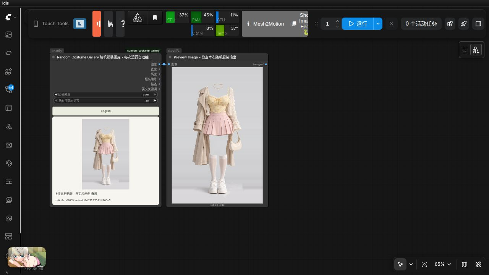
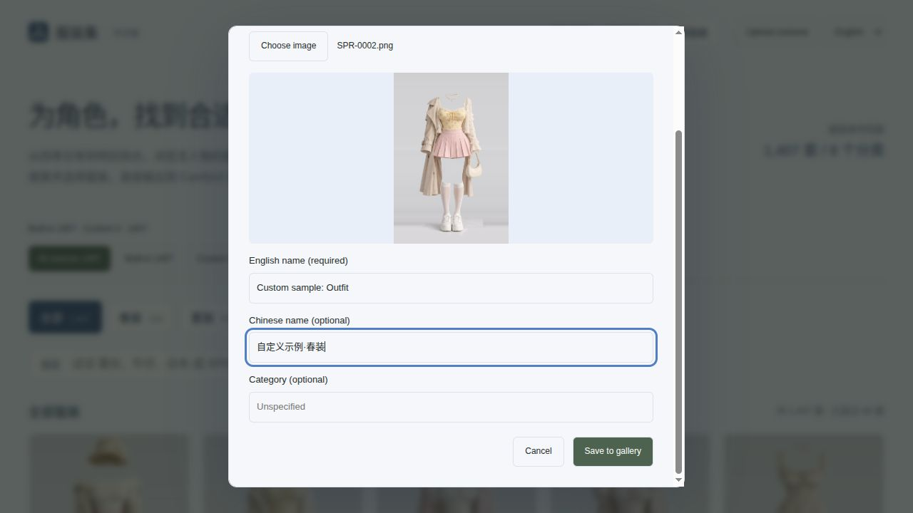
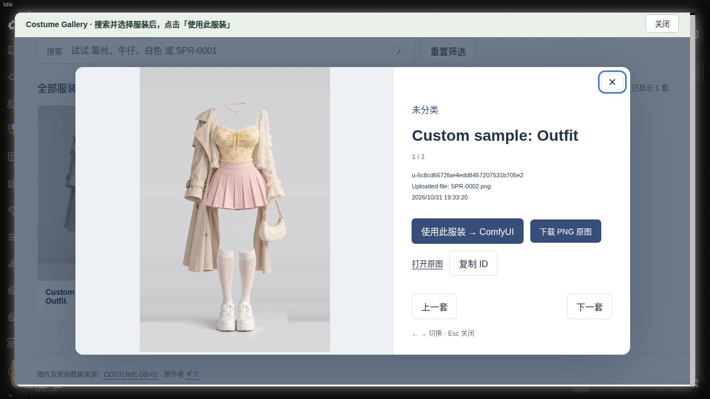

# comfyui-costume-gallery

**简体中文** · [English](README.en.md)

ComfyUI 本地中文服装图库节点，参考 [ai-costume-gallery-zh](https://github.com/wangweihong/ai-costume-gallery-zh) 的界面和素材。内置 1,407 套服装，8 个分类，包含全部 WebP 缩略图、WebP 预览图和 PNG 原图，共 4,221 张图片，约 1.42 GiB。


## 每次运行随机：独立节点

添加 **image → Costume Gallery → Random Costume Gallery 随机服装图库**，将 `image` 接入后续工作流或 Preview Image。每次执行会重新随机抽取一张原图，无需点击随机按钮。`origin` 可选 `all`（全部）、`builtin`（内置）或 `user`（自定义）。保留原分类与关键词语义；自定义素材的英文关键词仍为空，不自动编造标签。

原 **CostumeGallery** 的输入、固定选图、缓存、6个输出和连线均保持不变。新节点沿用这6个输出，所有数据对应同一张实际抽中的素材；执行后显示编号和预览。新节点的 `language` 切换界面、提示及自定义预览名称语言，端口数据仍沿用原节点语义，不补造内置描述的译文。

抽样可能偶然重复，不受浏览页面筛选影响；缺失原图会跳过，无可用图片时明确报错。保存的预览编号不参与下次抽样。需要固定结果时，将输出 `costume_id` 填入原节点。新节点本身不会启动或追加任务。

导入 [随机服装预览示例](example_workflows/random_costume_preview.json)，附同名 API 工作流。




## 单张上传自定义服装

1. 在独立图库或节点内嵌图库的顶部点击 **上传服装**。
2. 选择一张现成参考图，查看预览，填写名称。另一语言名称可选；未填写时沿用已有名称，不自动翻译。顶部 **中文 / English** 切换新增上传控件、提示和自定义名称的语言，原有内置图库浏览标签保持中文。
3. 点击 **保存到图库**。成功后切换到“自定义”来源，清除分类、搜索等筛选，并打开新素材的大图。
4. 在大图中点击 **使用此服装 → ComfyUI**，写回当前节点；上传和选择都不会自动运行或排队。

服装分类可选，默认未分类。用户名称作为名称保存，不编造服装标签；自定义素材的 keywords_en 输出为空字符串。

支持静态 PNG、JPEG、WebP，一次一张，限制 **20 MiB、3200 万像素**。服务端检查实际内容，拒绝动画、损坏图片和越界路径。完整图片转为 PNG，保留尺寸和透明度；生成 800×1000 内的 WebP 预览、400×500 内的 WebP 缩略图。节点 IMAGE 输出的透明部分合成白色。上传仅导入图片，**不自动提取、抠图、去背景或修改人物**。第一版不含批量导入、编辑和删除。

自定义数据保存在 **`ComfyUI/user/costume_gallery/`**，独立于节点代码与内置素材；升级代码不会覆盖：

- `data/custom.json`：稳定 `u-` + UUID 编号、中英文名称、分类、原文件名、尺寸、上传时间和校验值。
- png/（PNG）、img/（WebP）、thumbs/（WebP）：完整图、预览与缩略图，按同一编号对应。
- 备份时请单独备份此用户目录。本地 ComfyUI 服务的客户端共享该库，没有账号或多用户权限隔离。
- 可用 `COMFYUI_COSTUME_GALLERY_USER_LIBRARY` 指定其他持久化、可写且容器内可见的目录。

新增 **全部来源 / 内置 / 自定义** 筛选与独立数量统计；缺少内置索引时仍可上传与使用自定义素材。保留现有 **6 个输出**、旧编号和连线兼容；自定义编号用于 `costume_id`，`source_id` 元数据为空，不冒用原站编号。

接口：`POST /costume_gallery/upload`，multipart 字段 `image`、`name`，可选 `other_name`、`language`（zh/en）、`category`。成功返回201及 `record`、包含 `records` 和 `meta` 的 `catalog`；失败返回错误代码。索引加锁并原子替换，失败回滚本次新文件。`GET /costume_gallery/catalog` 保持数组格式，并增加 `origin=builtin/user`；`GET /costume_gallery/meta` 提供数量与缺失状态。图片接口只读取索引中登记的文件。






## 安装与使用

1. 在 `ComfyUI/custom_nodes/` 目录执行 `git clone https://github.com/wangweihong/comfyui-costume-gallery.git`，或将整个节点文件夹放入该目录，包括 `library/`。不需要另行下载素材或运行安装脚本。
2. 重启 ComfyUI，强制刷新浏览器（Ctrl+Shift+R）。
3. 添加 **image → Costume Gallery → Costume Gallery 服装图库** 节点。
4. 点击“浏览服装图库 · 搜索 / 分类 / 关键词”，在弹窗中选择春装、夏装、秋装、冬装、内衣、派对、泳装或性感分类。支持中文、英文关键词、ID 搜索；空格分隔多个词时按同时包含筛选。
5. 点击服装卡片查看大图，再点“使用此服装 → ComfyUI”。节点保存 `costume_id` 并显示 PNG 原图。
6. 将 `image` 接到预览或图像编辑工作流，点击运行。浏览和选择服装不会自动执行生成任务。

导入 [`example_workflows/costume_gallery_preview.json`](example_workflows/costume_gallery_preview.json) 可直接测试原图预览与保存；同名 `.api.json` 为服务端格式，不依赖打开图库页面。


## Pose Gallery + 服装图库 + Qwen Image 2.1

附带[通用三图工作流](example_workflows/pose_costume_qwen21_generic.json)：图一为姿势图库，图二为人物参考，图三为服装图库。使用固定的通用提示词，不写死动作、衣服或性别，切换素材后可直接运行。模型依赖、参考图顺序及完整说明见[三图流程指南](example_workflows/pose_costume_qwen21.md)。

## 节点输出

| 输出 | 类型 | 内容 |
| --- | --- | --- |
| `image` | IMAGE | PNG 原图，RGB，保持原始尺寸；透明区域合成白色背景 |
| `width` / `height` | INT | 原始图片宽高 |
| `costume_id` | STRING | 服装编号，如 `SPR-0001` |
| `description` | STRING | 中文分类及中文关键词 |
| `keywords_en` | STRING | 原始英文关键词 |

标签可能不完整，不能替代完整生成提示词。该节点负责提供服装参考图，本身不执行换装；需要将其输出接入支持图像参考的工作流。

## 内置素材

```text
comfyui-costume-gallery/
├── library/
│   ├── data/       # 原始及中文索引、分类、词典与素材清单
│   ├── thumbs/     # 1,407 张 WebP 缩略图
│   ├── img/        # 1,407 张 WebP 预览图
│   ├── png/        # 1,407 张 PNG 原图
│   └── SOURCE.json
├── web/            # ComfyUI 扩展和服装弹窗界面
└── example_workflows/
```

所有浏览、搜索、预览和节点输出均使用本地文件，运行时没有图片下载、统计或遥测。原图缺失时会显示对应文件路径和修复提示。不得只复制缩略图或 web 目录。

高级：`COMFYUI_COSTUME_GALLERY_LIBRARY` 可指定其他完整图库根目录，需包含 `data/`、`thumbs/`、`img/` 和 `png/`。服务端仅提供索引允许的文件，拒绝路径穿越和指向图库外的符号链接。

依赖使用 ComfyUI 已有的 Pillow、NumPy、PyTorch、aiohttp，无额外模型。

## 素材来源与许可

- 中文服装图库：[wangweihong/ai-costume-gallery-zh](https://github.com/wangweihong/ai-costume-gallery-zh)，上游维护者 Deeyu。
- 原始图库：[衣装集 COSTUME-DB-01](https://ai-costume-gallery.pages.dev/)，原作者 [ギア](https://x.com/giaaibusi)。
- 本节点改编了上游 MIT 许可的 HTML、CSS 和 JavaScript，保留 [LICENSE](LICENSE) 与 [第三方声明](THIRD_PARTY_NOTICES.md)。图片及原始数据不包含在代码 MIT 许可内，其使用范围由原权利人的条款决定。

## 本地验证

已完成全部4,221张素材的完整性校验，以及弹窗、ID搜索、中英文组合搜索、分类筛选、选择写回和PNG原图输出测试。示例 SPR-0002 输出1366×2048，RGB像素与原图一致。

三图Qwen工作流使用同一通用提示词完成跪姿春装与站姿冬装两组测试，整体动作和服装替换有效；帽子与袖型等细节仍可能偏差。

## 验证

```bash
python3 -m unittest discover -s tests -v
node --test tests/test_preview.mjs
node --check web/costume_gallery.js
node --check web/gallery.mjs
```

```bash
node --test tests/test_random_frontend.cjs
```
