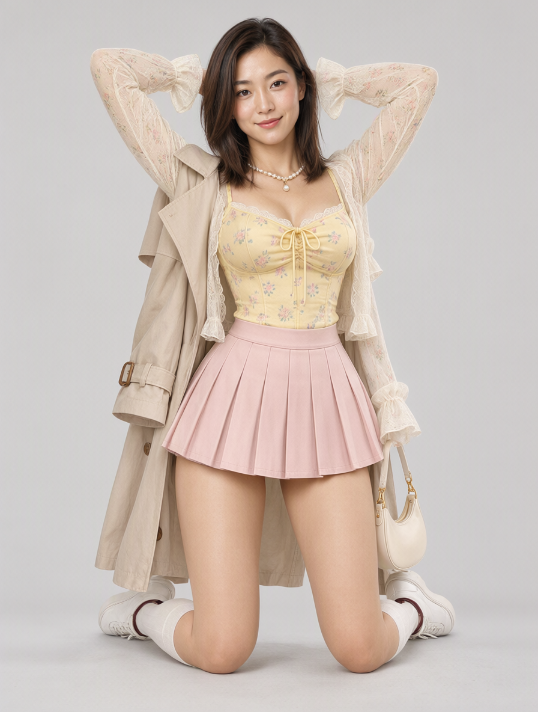
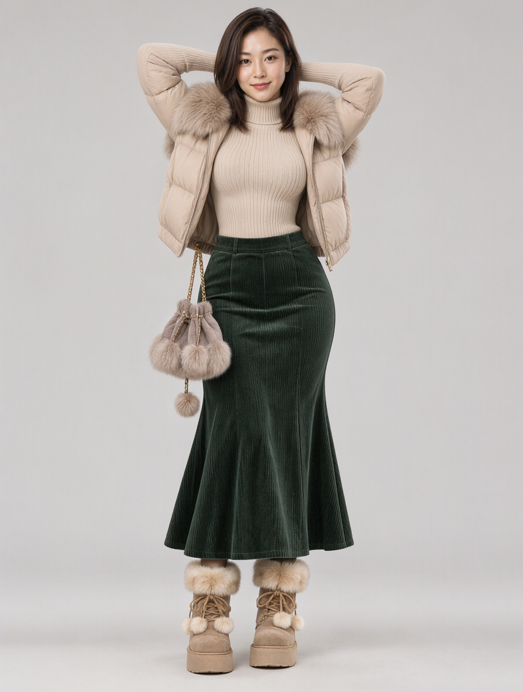
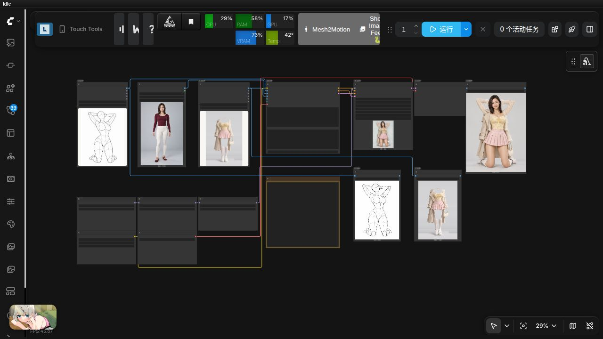

# Pose Gallery + Costume Gallery + Qwen Image 2.1 通用三图工作流

导入 [`pose_costume_qwen21_generic.json`](pose_costume_qwen21_generic.json)。API 版本为 [`pose_costume_qwen21_generic.api.json`](pose_costume_qwen21_generic.api.json)。

## 三张参考图的分工

| 端口 | 来源 | 用途 |
| --- | --- | --- |
| `images.image_1` | `comfyui-pose-gallery` 姿势图库 | 动作、四肢位置、身体朝向、相机视角和构图 |
| `images.image_2` | Load Image 人物参考 | 人物身份、脸部、发型、体型、画风、背景和光照 |
| `images.image_3` | `comfyui-costume-gallery` 服装图库 | 新服装、配饰、颜色、纹理、材质及穿搭层次 |

顺序不能交换。目标是同一个人物按姿势图摆动作，同时换上服装图的衣服。

## 使用

1. 安装本节点，以及 [comfyui-pose-gallery](https://github.com/wangweihong/comfyui-pose-gallery)。两个图库均应包含完整素材。
2. 将 [`assets/costume_gallery_person_reference.png`](assets/costume_gallery_person_reference.png) 复制到 `ComfyUI/input/`，或在 Load Image 中选择自己的单人参考图。
3. 导入工作流并在模型节点重选本机权重（如下表）。
4. 在 Pose Gallery 中浏览、搜索并“使用此姿势”；在 Costume Gallery 中浏览、搜索并“使用此服装”。检查两个节点均显示原图。
5. 保留附带通用提示词，点击运行。切换姿势、服装或人物时，无需填写固定动作、颜色或性别名称。

当前按单人人物、单套服装设计；多人姿势和多套服装拼图不在验证范围内。输出尺寸跟随第一张姿态参考的比例，默认约1MP（P031示例896×1184）。该流程直接使用姿势线稿，不经过 Depth Anything。

## 本地模型配置

| 模型节点 | 下拉框选择值 |
| --- | --- |
| Load Diffusion Model | `image2image/qwen_image_2.1_bf16.safetensors` |
| Load LoRA | `qwen2.1/动作编辑VNCCS_QI2_PoseStudioV2_3294845.safetensors` |
| Load CLIP | `text_encoders/qwen3vl_8b_bf16.safetensors`，类型 `qwen_image` |
| Load VAE | `vae/qwen_image_2.1_vae_bf16.safetensors` |

上述路径相对于各模型类型目录，为本机实际选择值；其他机器请重选本机目录。模型不包含在节点仓库中。LoRA 为 [QI2.1 专用 Pose Studio v2](https://huggingface.co/MIUProject/VNCCS_PoseStudio_QI2.1)，不要用 QIE2511 版本。本工作流不需要 VNCCS 3D 编辑节点。

25步、CFG1、Euler/simple、denoise1、种子20261029固定、LoRA强度1，不叠加Turbo LoRA。Qwen Image 2.1 Cache 为auto/default。

## 通用提示词

Create one coherent image from three references with separate roles. Image1 is the body-pose reference: follow its limb placement, body orientation, camera viewpoint and framing. Image2 is the person reference: preserve this person's identity, facial features, hairstyle, body characteristics, visual style, background and lighting. Image3 is the outfit reference: dress the person in the garments and accessories shown there, preserving their colors, patterns, materials, layering and design details. Change the pose of the person in image2 to the pose in image1 and replace their original outfit with the outfit in image3. Fit the clothes naturally to the posed body, with coherent folds and occlusion. Render the result in the visual style of image2. Do not copy the line drawing, invisible mannequin, display stand, reference background or annotations from the other references. Produce a single finished image of the person, not a reference sheet or collage.

## 输出

相对于 `ComfyUI/output`：

- `images/qwen2.1/pose_costume/results/`：编辑结果。
- `images/qwen2.1/pose_costume/poses/`：所用姿势原图。
- `images/qwen2.1/pose_costume/costumes/`：所用服装原图。

API 的多图输入须使用 `images.image_1`、`images.image_2`、`images.image_3` 这三个扁平键；不要手工改成嵌套 `images` 对象，否则当前 ComfyUI 版本可能忽略参考图。

## 实测结果

2026-10-29 使用完全相同的通用提示词和种子，切换姿势与服装，完成两组测试；模型已加载时约22秒/张。

| 姿势与服装 | 结果 |
| --- | --- |
| P031跪姿 + SPR-0002春装 |  |
| P002站姿 + WIN-0001冬装 |  |

两组都实现整体姿态变化、人物脸部与发型保留和目标服装替换。冬装示例遗漏帽子，羽绒外套袖型也有偏差；配饰、叠穿关系和精确身份不能保证完全一致。复杂遮挡、多人、背身和其他服装尚未系统验证。详细参数见[实测摘要](pose_costume_qwen21_validation.json)。

